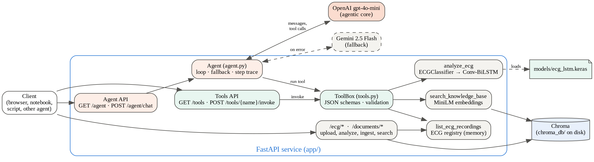
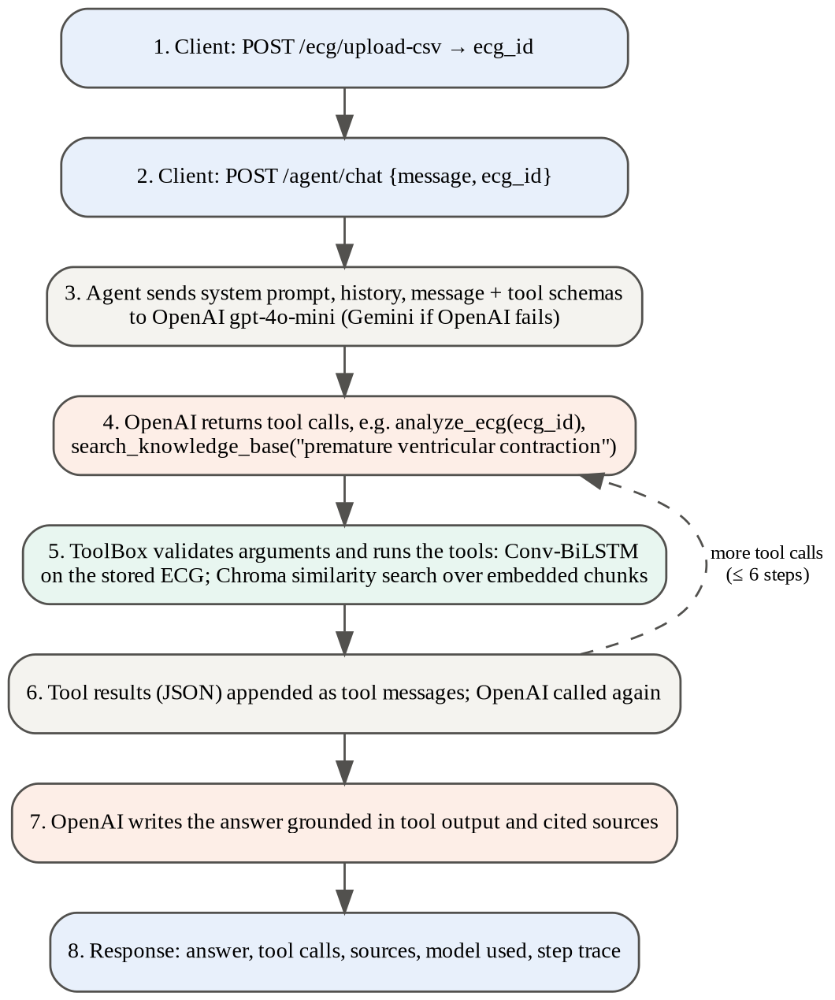
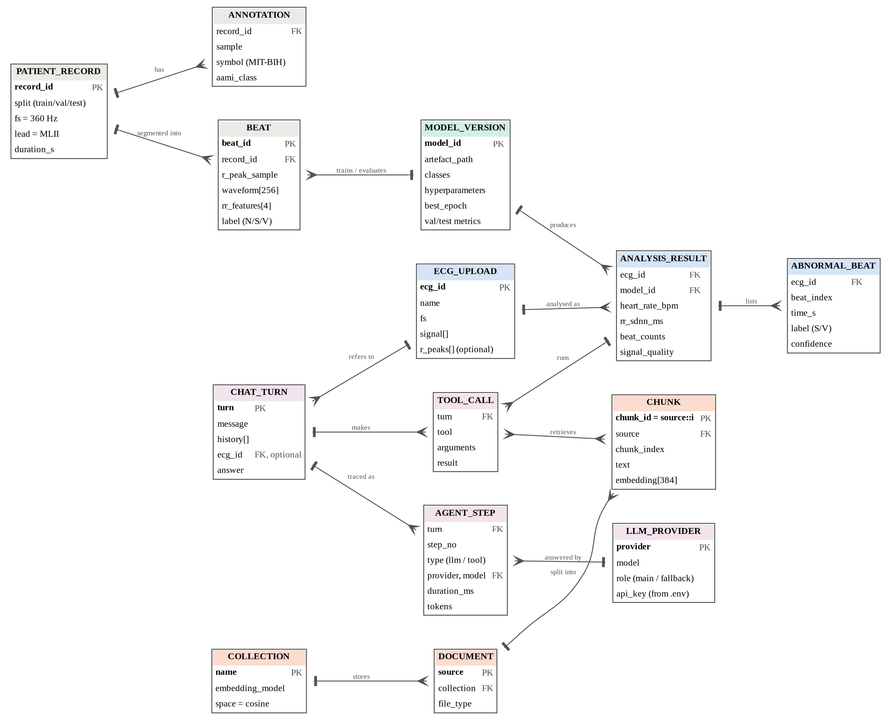

# Architecture

How the system is built: components, the agent/tool split, request flows, the data model (ERD) and the main
design decisions. For endpoint details see [API.md](API.md); for the model see [MODEL_CARD.md](MODEL_CARD.md).

## 1. Overview

| Layer | Module | Responsibility |
|---|---|---|
| Agentic core | `app/agent.py` | conversation with the LLM, tool-call loop (max 6 LLM calls), provider fallback, step trace, system prompt |
| Tools | `app/tools.py` | tool JSON schemas, argument validation, handlers, ECG registry; no LLM code |
| ECG model | `app/ecg/` | preprocessing, R-peak detection, segmentation, RR features, signal quality, LSTM inference, evaluation |
| Knowledge base | `app/vector_store.py`, `embeddings.py`, `ingest.py` | text extraction, chunking, local embeddings, persistent Chroma |
| HTTP | `app/routers/`, `main.py`, `schemas.py`, `deps.py` | REST endpoints, request/response models, start-up wiring |
| Configuration | `app/config.py` | settings from `.env`, provider resolution (OpenAI / Gemini / custom) |

All long-lived objects (Chroma client, embedder, Keras model, registry, agent) are created once in the FastAPI
lifespan and shared through `AppState`.

## 2. Agent and tools

OpenAI `gpt-4o-mini` is the **agentic core**: it reads the question, decides which tools to call and writes the
answer. The trained LSTM is one of its **tools**.

| Tool | Runs | Returns |
|---|---|---|
| `analyze_ecg(ecg_id)` | `ECGClassifier.analyze` on a stored recording | heart rate, SDNN, beat counts and percentages, abnormal beats with confidence, signal quality, disclaimer |
| `search_knowledge_base(query, top_k)` | Chroma similarity search over embedded chunks | ranked chunks with source, index and score |
| `list_ecg_recordings()` | registry listing | ids, names, sampling rates, durations |

The tools are exposed twice, from the same `ToolBox` object:

- **to the LLM** via `ToolBox.run`: any failure becomes `{"error": ...}` so the model can recover;
- **to HTTP clients** via `POST /tools/{name}/invoke` and `ToolBox.invoke`: failures become status codes (404, 422, 503).

Arguments are validated against each tool's JSON schema in both paths (required, unknown and wrongly typed fields).

### Providers

| `LLM_PROVIDER` | Key | Endpoint | Default model |
|---|---|---|---|
| `openai` (main) | `OPENAI_API_KEY` | `https://api.openai.com/v1` | `gpt-4o-mini` |
| `gemini` (fallback) | `GEMINI_API_KEY` | `https://generativelanguage.googleapis.com/v1beta/openai/` | `gemini-2.5-flash` |
| `custom` | `LLM_API_KEY` | `LLM_BASE_URL` (Ollama, vLLM, LM Studio) | `LLM_MODEL` |

All three speak the OpenAI Chat Completions API with tool calling, so one client library serves them. If a call to
the main provider raises `openai.APIError` (authentication, quota, rate limit, outage), the agent repeats it on the
fallback and keeps using the fallback for the rest of that request. If both fail, `/agent/chat` returns 502.

## 3. Request flows

### Agent question about an ECG

1. `POST /ecg/upload` stores the signal in the registry and returns an `ecg_id`.
2. `POST /agent/chat {message, ecg_id}`: the agent builds `[system prompt, history, user message + ecg_id]`.
3. LLM call 1: OpenAI returns tool calls, e.g. `analyze_ecg(ecg_id)`.
4. The ToolBox validates and runs the tool; the JSON result is appended as a `tool` message.
5. LLM call 2: OpenAI writes the answer from the tool result (or asks for more tools; at most 6 LLM calls).
6. The response carries the answer, tool calls, cited sources, the model used and the step trace.

Measured on a laptop (record 233, 30 s): LLM call 1 ≈ 2.6 s, tool ≈ 0.1 s, LLM call 2 ≈ 2.6–7 s depending on answer
length. The LLM dominates latency; the classifier is not the bottleneck.

### Direct analysis (no LLM)

`POST /ecg/{id}/analyze` or `POST /tools/analyze_ecg/invoke` run the same pipeline:
resample to 360 Hz → band-pass 0.5–40 Hz → R-peak detection (or supplied peaks) → 256-sample beats, z-scored →
4 patient-relative RR features → Conv-BiLSTM → counts, abnormal beats, signal quality. A 30-minute recording takes
about 1.3 s.

### Document ingestion

`POST /documents/upload` → text extraction (PDF, TXT, MD) → recursive chunking (800 characters, 120 overlap) →
all-MiniLM-L6-v2 embeddings (384 dimensions, ONNX, CPU) → upsert into Chroma with ids `source::index`. An existing
source is deleted first, so re-uploading replaces rather than duplicates.

## 4. Data model

The ERD is logical: some entities live in files, Chroma or memory rather than in a relational database.

| Entity | Stored in | Key fields | Notes |
|---|---|---|---|
| PATIENT_RECORD | `data/mitdb/*.dat/.hea` | record_id | 48 MIT-BIH records, 360 Hz, MLII lead; split train / validation / test by patient |
| ANNOTATION | `data/mitdb/*.atr` | record_id, sample, symbol | cardiologist beat labels, mapped to AAMI classes |
| BEAT | built in memory (`mitbih.record_beats`) | record_id, r_peak_sample | 256-sample waveform, 4 RR features, label |
| MODEL_VERSION | `models/ecg_lstm.keras`, `ecg_lstm_meta.json` | file path | classes, preprocessing constants, split records, hyperparameters, metrics, baselines |
| ECG_UPLOAD | in-memory `ECGRegistry` | ecg_id (12 hex chars) | signal, fs, optional R-peaks, name, created_at; lost on restart |
| ANALYSIS_RESULT | computed per request | ecg_id | returned by `/ecg/{id}/analyze` and the `analyze_ecg` tool; not stored |
| ABNORMAL_BEAT | inside ANALYSIS_RESULT | ecg_id, beat_index | time, S/V label, confidence (max 50 listed) |
| COLLECTION | Chroma (`chroma_db/`) | name | metadata `embedding_model`; cosine HNSW index |
| DOCUMENT | Chroma metadata | source | file name used as identifier |
| CHUNK | Chroma | `source::index` | text, 384-d embedding, source, chunk_index |
| CHAT_TURN | request/response only | | message, history, optional ecg_id, answer; the server keeps no chat history |
| TOOL_CALL | response `tool_calls` | | tool name and arguments; results go to the LLM |
| AGENT_STEP | response `steps` | step order | type (llm / tool), provider, model, duration, tokens, success, error |
| LLM_PROVIDER | `.env` | provider | model, role (main / fallback), API key |

## 5. Design decisions

| Decision | Reason |
|---|---|
| Patient-wise splits and selection on validation macro-F1 | random beat splits leak patients and inflate accuracy; accuracy is dominated by normal beats |
| Patient-relative RR features only | absolute RR intervals identified patients and caused over-fitting (model v1) |
| N/S/V classes only | fusion beats in the training pool come almost entirely from one patient (model v2 failed on them) |
| One preprocessing module for training and serving | beats at inference are built exactly like training beats |
| Tools separate from the agent | the LSTM can be used by any client or agent, tested without an LLM, and swapped independently |
| OpenAI-compatible interface for every provider | one code path for OpenAI, Gemini and local models; fallback is a configuration change |
| Raw signal never sent to the LLM | smaller prompts, lower cost, less data leaves the machine; the LLM needs only the summary |
| Local embeddings and persistent Chroma | RAG works without an embedding API key and survives restarts |
| Kurtosis signal-quality check | the beat detector finds "beats" in noise; flagged results are not interpreted by the agent |
| Step trace in every agent response | makes the agent's behaviour observable for users, tests and the project report |

## 6. Deployment notes

- Single process: `uvicorn app.main:app --host 0.0.0.0 --port 8000`. TensorFlow, the Keras model and the embedder
  load once at start-up; the service is CPU-only.
- State: `chroma_db/` and `models/` on disk; uploaded ECGs in memory. For several workers or restarts, move the
  registry to Redis or a database.
- Secrets live only in `.env` (gitignored). There is no authentication; put the service behind a gateway before
  exposing it.
- Data leaving the machine: questions, history and tool results go to the LLM provider; use `LLM_PROVIDER=custom`
  with a local model to avoid this.
